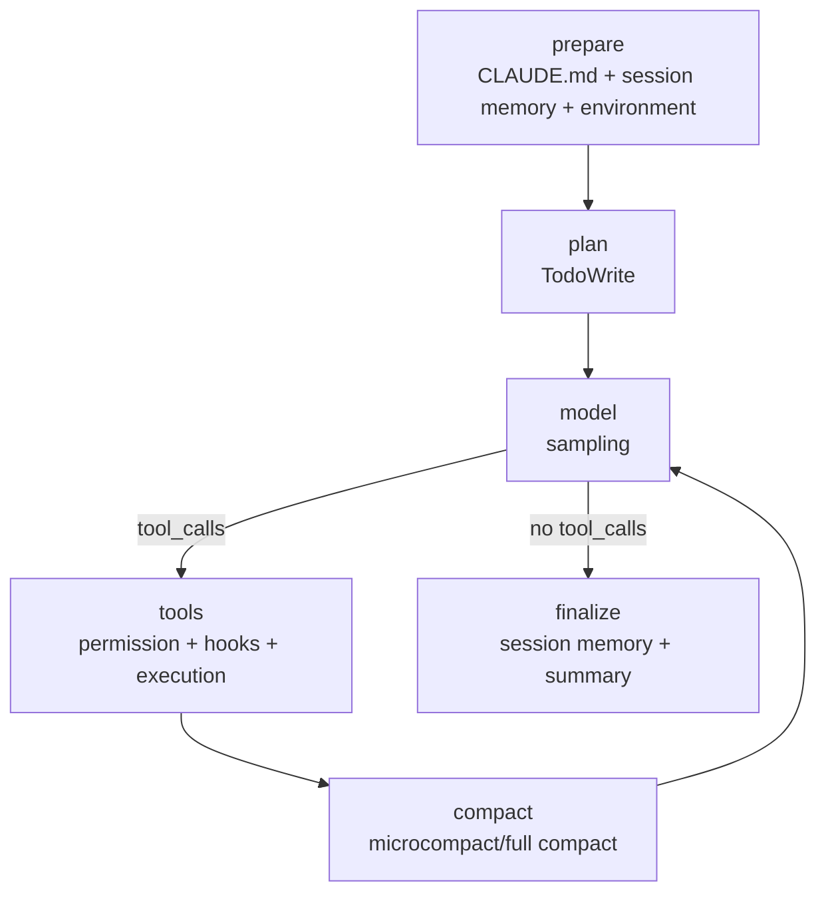

# Claude-style LangGraph Harness 架构

## 0. 先说明源码来源

本项目的 Claude 参考材料来自你给出的：

- `D:\workspace\agent\claudecode\Claude-Code-Source-Study\docs\`
- `D:\workspace\agent\claudecode\claude-code-sourcemap\restored-src\`

其中第二份是从 Claude Code 发布包 sourcemap 恢复出的源码/研究材料，不是 Anthropic 官方开源仓库。下面的“源码对应”是架构学习用的对照，不代表原始项目以官方开源许可证发布。

官方产品文档用于核对概念：

- Claude tool use：https://docs.anthropic.com/en/docs/build-with-claude/tool-use/overview
- Claude thinking：https://docs.anthropic.com/en/docs/build-with-claude/extended-thinking
- Claude prompt caching：https://docs.anthropic.com/en/docs/build-with-claude/prompt-caching
- Claude Agent SDK / CLAUDE.md cookbook：https://platform.claude.com/cookbook/claude-agent-sdk-01-the-chief-of-staff-agent

## 1. Claude Code 的 queryLoop 怎么变成 LangGraph

Claude Code 的核心循环在 `src/query.ts` 的 `queryLoop`：

```text
用户输入
  → 构建/压缩上下文
  → 调用模型
  → 如果返回 tool_use：执行工具，把 tool_result 放回消息
  → 再次调用模型
  → 如果只返回 assistant message：结束 turn
```

本项目的 `claude_harness/harness.py` 用 LangGraph 显式建模：



对应关系：

| Claude Code | 本项目 |
|---|---|
| `query.ts::queryLoop` | `ClaudeHarness.run()` + LangGraph nodes |
| `Tool.ts::Tool` | `claude_harness/tools.py` + `permissions.py` |
| tool-use/tool-result 消息 | `AIMessage.tool_calls` + `ToolMessage` |
| `context.ts` / `utils/claudemd.ts` | `claude_harness/context.py` |
| `services/compact/` | `ClaudeContextManager.maybe_compact()` |
| `Task.ts` / `LocalAgentTask` | `agent_runtime/` + `claude_harness/multi_agent.py` |
| `SendMessageTool` / `TaskOutputTool` | `SendMessage` / `TaskOutput` tools |
| `mcp.ts` / MCP tools | `claude_harness/mcp_client.py` |

## 2. 上下文层

`ClaudeContextManager` 按 Claude Code 的思路组合：

1. `CLAUDE.md`
2. `.claude/CLAUDE.md`
3. `.claude/rules/*.md`
4. `CLAUDE.local.md`
5. 当前环境（OS、Python、Git、顶层文件）
6. `.claude/session-memory/summary.md`
7. 当前 Todo 和对话/工具结果

它和 Codex 的 `AGENTS.md` 是同一类机制：**项目级持久指令**。区别主要是文件名、发现层级和具体合并策略。

## 3. 工具和权限

工具名刻意贴近 Claude Code：

- `Read`
- `Glob`
- `Grep`
- `Explore`
- `Write`
- `Edit`
- `Bash`
- `TodoWrite`
- `GitStatus` / `GitDiff`

权限模式：

| 模式 | 行为 |
|---|---|
| `default` | 只读自动允许；写/命令询问或拒绝 |
| `plan` | 只读探索；写文件和命令拒绝 |
| `acceptEdits` | 自动允许 Write/Edit；安全测试命令允许 |
| `bypassPermissions` | 全部允许，仅适合可信临时仓库 |
| `dontAsk` | 需要询问的操作直接拒绝 |

这不是 OS 级沙箱。真正的 Claude Code/Codex 还会用 OS sandbox、路径权限、网络策略和更细的规则链；本项目用 workspace 边界、敏感文件过滤和命令 allowlist 做简化版。

## 4. 上下文压缩

`maybe_compact()` 先做 `microcompact`：

- 找出旧的 `ToolMessage`；
- 保留最近 4 个；
- 把更早的工具结果替换为 `[Old tool result content cleared by microcompact]`。

如果仍然超过预算，再做 `full_compact`：

- 保留头部系统/任务上下文；
- 用一条压缩摘要代替中间旧消息；
- 保留最近 8 条消息；
- 下一次模型采样继续。

这对应 Claude Code 的 `microCompact.ts` 和 `compact.ts` 思路。真实 Claude Code 会调用一个专门模型生成 9 段摘要；本项目为了学习和可预测性，先用确定性摘要。

## 5. 多 Agent 和通信

`claude_harness/multi_agent.py` 提供：

- `Task`：启动一个只读 Explore/Plan 子 Agent；
- `SendMessage`：向子 Agent mailbox 投递消息；
- `TaskOutput`：等待子 Agent，读取状态和结果；
- `TaskList`：列出 Agent 状态；
- `CloseAgent`：请求停止子 Agent。

子 Agent 的通信点是一个关键设计：

```text
父 Agent 调用 SendMessage
  → 消息进入子 Agent inbox
  → 子 Agent 当前模型调用不会被强行修改
  → 下一轮模型采样前 drain inbox
  → 子 Agent 把消息作为新的 HumanMessage 纳入上下文
```

这类似于 Claude Code 的 `pendingMessages` 在 tool-round boundary 被消费。

## 6. MCP

`claude_harness/mcp_server.py` 暴露两个只读工具：

- `repo_stats`
- `find_todos`

`claude_harness/mcp_client.py` 用 `langchain-mcp-adapters` 通过 stdio 连接 server，
发现工具后把 async MCP tool 包装成同步 LangGraph 节点可调用的工具。

运行：

```powershell
Copy-Item examples/claude_harness_demo $env:TEMP/claude_harness_demo -Recurse -Force

uv run python -m claude_harness `
  --workspace $env:TEMP/claude_harness_demo `
  --task "用 Task 委派 explore，运行 MCP repo_stats，修复 add，跑 pytest" `
  --permission-mode acceptEdits --auto-approve --enable-mcp `
  --verify-command "python -m pytest -q"
```

## 7. 事件和可视化

运行目录：

```text
<workspace>/.claude/runs/<timestamp>/
├── events.jsonl
├── timeline.md
├── summary.md
└── changes.diff
```

事件包括：

- `context_prepared`
- `todo_created` / `todo_updated`
- `model_request` / `agent_message`
- `permission_decision`
- `hook_pre_tool` / `hook_post_tool`
- `tool_started` / `tool_finished`
- `context_compacted`
- `subagent_spawned` / `subagent_message_queued` / `subagent_completed`
- `mcp_tools_loaded`
- `verification_completed`

## 8. 和 Codex 的差异

| 维度 | Claude-style `claude_harness` | Codex-style `mini_codex` |
|---|---|---|
| 编排 | LangGraph 显式 queryLoop | 自定义 run_turn 循环 |
| 项目指令 | `CLAUDE.md` | `AGENTS.md` |
| 计划 | `TodoWrite` | `update_plan` |
| 权限 | permission modes + hooks | 路径/命令边界 |
| 压缩 | microcompact/full compact | 历史裁剪 |
| 多 Agent | Task/SendMessage/TaskOutput | spawn/send_input/wait |
| MCP | 独立 `mcp_client.py` | `langchain_cases/case10_mcp.py` 示例 |

两者共享一个核心事实：**Agent 不是模型本身，而是模型外面的上下文、工具、循环、权限和事件运行时。**
