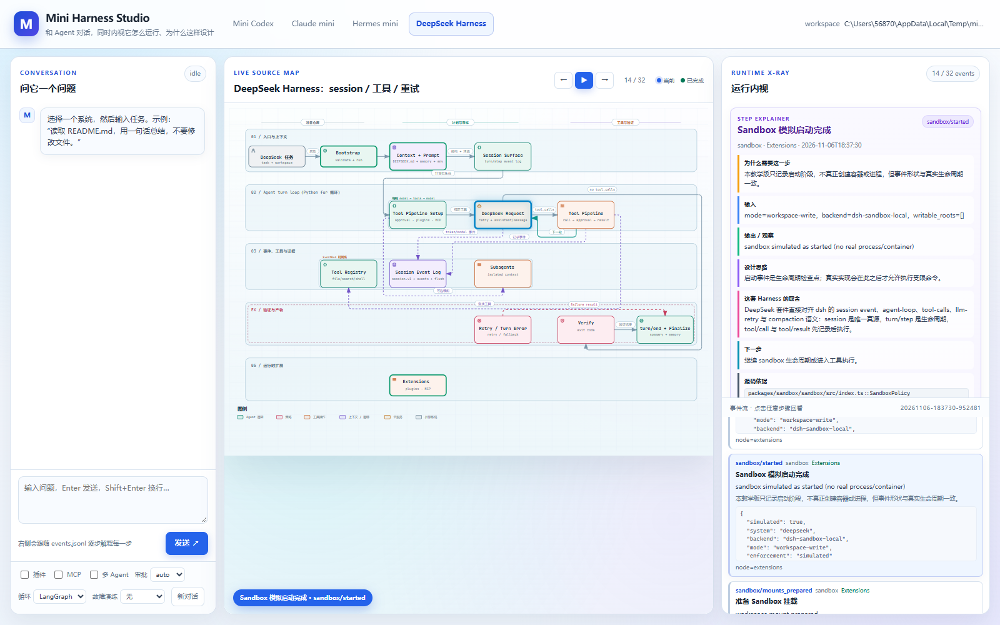

# Sandbox 启动日志模拟

> 本功能只记录 sandbox 生命周期日志，**不会真正创建容器、进程或内核沙箱**。

## 源码依据

### Codex

- `codex-rs/protocol/src/protocol.rs::SandboxPolicy`
- `codex-rs/core/src/sandboxing/`
- `codex-rs/linux-sandbox`、`windows-sandbox-rs`

Codex 把 sandbox policy 作为 TurnContext 的一部分，命令执行前由 sandbox
runner 包装。本项目只模拟 policy、backend 和生命周期，不启动真实 runner。

### Claude Code

- `restored-src/src/utils/sandbox/sandbox-adapter.ts::SandboxManager`
- `restored-src/src/entrypoints/sandboxTypes.ts`
- `restored-src/src/utils/sandbox/`

Claude 通过 SandboxManager 管理 sandbox 是否启用、不可用原因和网络权限请求。
本项目模拟这些阶段，不启动真实 sandbox-manager。

### Hermes

- `tools/environments/`
- `toolsets.py`

Hermes 的 terminal tool 可以在本地、Docker、SSH、Modal 等环境后端间切换；
本项目只模拟当前环境的选择和启停事件。

### DeepSeek Harness

- `packages/sandbox/sandbox/src/index.ts::SandboxPolicy`
- `packages/sandbox/sandbox-local/src/index.ts`
- `packages/sandbox/sandbox-windows-acl/src/index.ts`
- `packages/core/session/src/types.ts::sandbox/mode`

DeepSeek 的 sandbox 是 Cordis service seam；本次只在 dsh session 中记录
`sandbox/mode`，并通过共享模拟器产生启动/停止日志。

## 事件序列

```text
sandbox/requested
→ sandbox/backend_selected
→ sandbox/policy_applied
→ sandbox/mounts_prepared
→ sandbox/started
→ sandbox/exec_wrapped（可选）
→ sandbox/stop_requested
→ sandbox/stopped
```

每个事件都带有：

- `simulated: true`
- `system`
- `mode`
- `backend`
- `writable_roots`
- `network_access`
- `source_refs`

## 为什么这样设计

1. **先策略、后执行**：sandbox 必须在工具产生副作用前确定，否则日志只能解释“已经发生的事故”。
2. **backend 与 policy 分离**：Windows ACL、Linux landlock、容器和远程环境是不同 provider，但上层只关心 mode 和边界。
3. **启动/停止都记录**：只记录 started 会让资源泄漏和异常退出不可见。
4. **显式 simulated**：避免把教学模拟误认为真实隔离。
5. **命令包装单独记录**：sandbox 真正作用于工具的地方是 exec wrapper，而不是“启动”本身。

## 前端查看

运行后打开 `Mini Harness Studio`，切换到 DeepSeek，点击“下一步”，
在事件流中选择 `sandbox/started`。右侧会显示 mode、backend、writable roots、
simulated 标志和源码依据。



## 运行

所有四套 Mini Harness 在运行时都会自动产生 sandbox 模拟事件：

```powershell
uv run python -m deepseek_harness.demo
uv run python -m deepseek_harness --workspace examples/deepseek_harness_demo `
  --task "读取 README.md 并总结，不要修改文件"
```

运行后在 `events.jsonl` 中搜索：

```text
sandbox/requested
sandbox/started
sandbox/stopped
```

DeepSeek 还会在 `session.v1.jsonl` 中记录 `sandbox/mode`。

