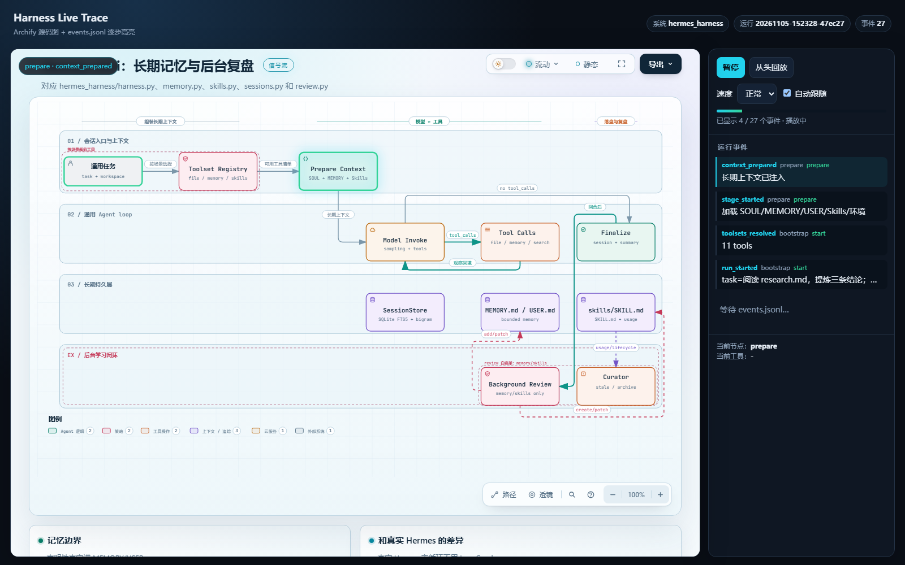

# 源码级系统流程图

这里的 HTML 由 **Archify** 生成，和普通“画个框图”不同：

- 每个节点带仓库相对路径和行号；
- 点击节点上的 source 标记，可以跳到对应 GitHub 提交中的源码；
- 图中区分“真实执行节点”和“逻辑/可选路径”；
- 运行事件目录里的 `events.jsonl` / `timeline.md` 可以和图中的节点名对照。

## 图

| 图 | 内容 | 运行后对照 |
|---|---|---|
| [Mini Codex](mini-codex.html) | `bootstrap → context → plan → agent(model/tools) → verify → finalize` | `.mini_codex/runs/*/events.jsonl` |
| [Claude Harness](claude-harness.html) | LangGraph `prepare → plan → model → tools → compact → finalize`，含权限、hooks、MCP/子 Agent 的挂载点 | `.claude/runs/*/events.jsonl` |
| [Hermes mini](hermes-harness.html) | `prepare → model → tools → finalize → background_review`，标明 MEMORY/USER/SKILL/FTS 的持久层 | `.hermes/runs/*/events.jsonl` |
| [DeepSeek Harness](deepseek-harness.html) | `context → plan → model(reasoning) ↔ tools`，含 retry、checkpoint、session memory、插件/MCP/多 Agent | `.deepseek/runs/*/events.jsonl` |
| [Support Project](support-project.html) | 同一售后问题在 5 个框架中的不同控制流；共享业务域单独标出 | `support_project.runner` 的返回值 |

## 如何把运行轨迹和节点对上

四套 mini Harness 都会写 JSONL。常用事件名：

```text
run_started
context_prepared / context_built
plan_created / todo_created
model_request
tool_started / tool_finished
context_compacted
verification_completed
turn_completed / query_completed
review_completed
turn/start, step/start, step/end, turn/end
user/message, request/header, assistant/message, assistant/attempt
tool/call, tool/result
llm/retry, llm/retry-started
session/flush
compaction/start, compaction/prune, compaction/summary, compaction/end
approval/policy, approval/asked, approval/decided
fallback_applied / failure_summary / limit_reached
```

DeepSeek 事件的源码依据见 [../source-provenance.md](../source-provenance.md)。

例如查看 Hermes 一次运行的阶段：

```powershell
$run = Get-ChildItem $env:TEMP/hermes_harness_demo/.hermes/runs | Sort-Object Name | Select-Object -Last 1
Get-Content (Join-Path $run.FullName "events.jsonl")
Get-Content (Join-Path $run.FullName "timeline.md")
```

注意：流程图展示的是源码中**存在**的路径，不代表每次运行都会经过所有可选分支。

如果想把运行中的阶段实时映射到图节点，可以使用：

```powershell
python docs/system-maps/trace_to_map.py --system hermes_harness `
  --run-dir "$env:TEMP/hermes_harness_demo/.hermes/runs/<timestamp>" --watch
```

该脚本输出 `stage → node`、事件类型和工具名；它不修改 Harness，也不读取 `.env`。

## 实时逐步播放

`live_viewer.py` 会启动一个本地 HTTP 服务，把 Archify 图嵌入页面，并轮询当前 run 的 `events.jsonl`：

- 高亮当前阶段对应节点；
- 已完成节点保留绿色描边；
- 右侧显示事件流、当前节点、当前工具和进度；
- 支持暂停、继续、从头回放和播放速度；
- 运行中的会话会持续读取新事件。

先运行案例，再查看最新一次 Hermes 运行：

```powershell
uv run python docs/system-maps/live_viewer.py `
  --system hermes_harness `
  --workspace $env:TEMP/hermes_harness_demo `
  --open
```

也可以在运行前指定具体 run 目录并保持页面打开：

```powershell
uv run python docs/system-maps/live_viewer.py `
  --system hermes_harness `
  --run-dir "$env:TEMP/hermes_harness_demo/.hermes/runs/<timestamp>"
```

服务只读取该 run 目录的 `events.jsonl` 和本目录里的静态 HTML，不读取 `.env`。

也可以直接用统一入口，它会启动 Viewer 并自动跟随该 workspace 最新 run：

```powershell
uv run python main_mini.py --system hermes --workspace $env:TEMP/hermes_harness_demo
```



## 重新生成

候选 JSON 在 `docs/system-maps/sources/`，输出 HTML 也在本目录。修改源码后：

```powershell
node D:\.codex\skills\archify\bin\archify.mjs finalize workflow `
  docs/system-maps/sources/mini-codex.workflow.json `
  docs/system-maps/mini-codex.html `
  --repo-root . --quality showcase --json
```

五张 Harness 图分别替换 source/output 路径即可。`--repo-root` 会把 source 引用固定到当前 Git 提交。
