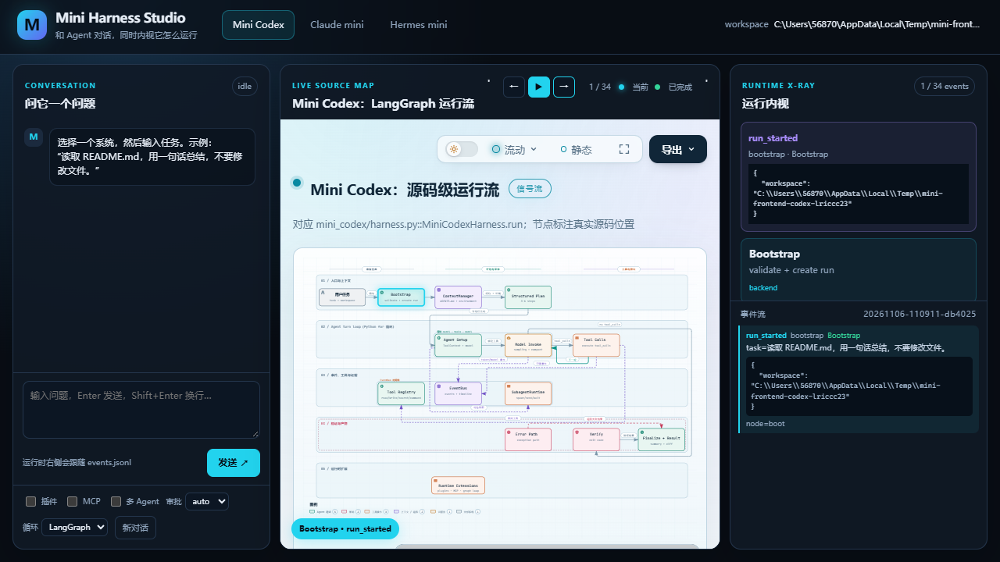

# Mini Harness Studio 前端

这是 Codex / Claude / Hermes 三套 mini Harness 的本地 Web 前端。



## 启动

```powershell
uv run python frontend/server.py --open
```

默认地址：

```text
http://127.0.0.1:8780/
```

服务只绑定本机 `127.0.0.1`，不会把 API Key 或 `.env` 发送到浏览器。

## 页面结构

- 左侧：对话、插件/MCP/多 Agent/审批选项；
- 中间：当前系统的 Archify 源码流程图；
- 右侧：当前节点的源码片段、事件参数、工具输出。

## 逐步内视

每次提问后不会自动跳完整个流程，而是保留事件序列：

```text
← 上一步     ▶/❚❚ 播放/暂停     → 下一步
```

每点一次“下一步”，就消费一条 `events.jsonl`：

- 当前节点高亮；
- 已走节点标绿；
- 事件参数显示在事件卡中；
- 节点源码在 `RUNTIME X-RAY` 中展示；
- 点击事件可以重新查看当时的参数。

## 工作区

启动时会把三个 demo 复制到临时目录，避免修改 `examples/`：

```text
<temp>/mini-frontend-codex-*/
<temp>/mini-frontend-claude-*/
<temp>/mini-frontend-hermes-*/
```

每次提问生成一个新的 run，前端自动跟随最新 run。

## 后端接口

```text
GET  /api/config
GET  /api/trace?system=codex
GET  /api/node?system=codex&node=model
GET  /diagram?system=codex
POST /api/chat
POST /api/reset
```

`/api/chat` 请求体：

```json
{
  "system": "codex",
  "message": "读取 README.md 并总结",
  "options": {
    "plugins": true,
    "mcp": false,
    "multi_agent": true,
    "approval_mode": "auto",
    "engine": "langgraph"
  }
}
```

## 边界

- 前端是本地教学工作台，不是生产级 Web UI；
- 每次对话通过历史摘要重新送入 Harness，不是持久 conversation engine；
- 事件通过 `events.jsonl` 轮询，不是 WebSocket；
- Claude 的权限选择使用它自己的 `permission mode`；
- Hermes 的后台 review 默认开启，会额外产生模型调用，可通过后端选项扩展关闭。

